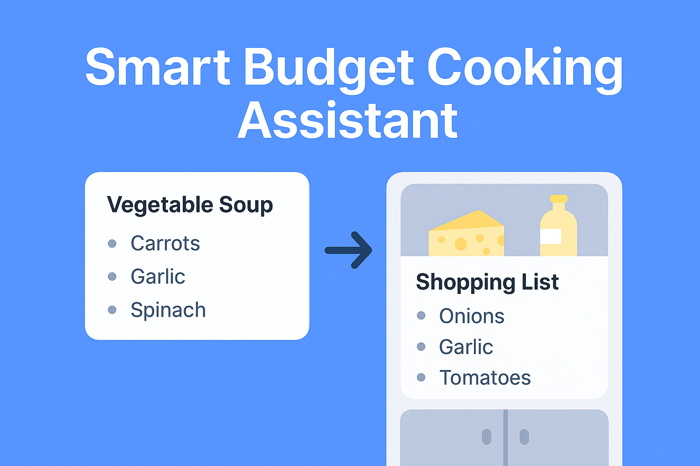

# 🍳 Smart Budget Cooking Assistant

Plan meals, control costs, and cook simply.  
Built with **React + Vite + Firebase + Tailwind CSS**, deployed on **Vercel**.




---

## ✨ Features

- 🗓️ **Weekly dinner planner**: a Monday–Sunday board; pick a dinner for each day, swap or remove it, and browse past and future weeks.
- 💰 **Budget tracking**: set a weekly budget and watch a live bar show what's planned, what's left, and when you go over.
- ✨ **Auto-fill my week**: fills empty days with varied dinners that fit the remaining budget (keeps the days you already chose).
- 🛒 **Shopping list**: combines the ingredients from the week's dinners into one checklist grouped by store section, shows which meals need each item, saves check-offs per week, and copies to text.
- 🤖 **Dinner ideas from your pantry**: list what you have, and a serverless API asks Claude (Haiku 5.5) for 3 cheap dinners that use it, fit the remaining budget and respect dietary tags. Save an idea or drop it straight onto a day.
- 📚 **Starter recipe library**: 24 budget dinners with ingredients, steps, servings and estimated costs, so new users can plan right away.
- 🍲 **Your own recipes**: add family favorites with servings and total cost; cost per serving is calculated for you.
- 🔐 **Authentication**: email/password sign-up, login and password reset with Firebase Auth.
- 🛡️ **Firestore security rules**: users can only read and write their own profile, recipes and plans ([`firestore.rules`](firestore.rules)).

---

## 🛠️ Tech Stack

- **Frontend**: React 18 + Vite 5
- **Styling**: Tailwind CSS + custom Apple-style components
- **Auth & DB**: Firebase Authentication + Firestore
- **Back end**: Vercel serverless function (`api/suggest.mjs`) with Firebase Admin and the Anthropic SDK
- **AI**: Claude Haiku 5.5 with tool use for structured JSON output
- **Hosting/CI**: Vercel (GitHub integration)

---

## 🚀 Live Demo

👉 **[smart-budget-cooking-assistant.vercel.app](https://smart-budget-cooking-assistant.vercel.app)**

---

## ⚙️ Setup (Local Development)

1. **Clone the repo**
   ```bash
   git clone https://github.com/gerardjosraudale/smart-budget-cooking-assistant.git
   cd smart-budget-cooking-assistant
   ```

2. **Install dependencies**
   ```bash
   npm install
   ```

3. **Add environment variables** — create a `.env.local` file in the project root:
   ```env
   VITE_FIREBASE_API_KEY=your_api_key
   VITE_FIREBASE_AUTH_DOMAIN=your_project.firebaseapp.com
   VITE_FIREBASE_PROJECT_ID=your_project_id
   VITE_FIREBASE_STORAGE_BUCKET=your_project.appspot.com
   VITE_FIREBASE_SENDER_ID=your_sender_id
   VITE_FIREBASE_APP_ID=your_app_id
   ```
   These values are in **Firebase Console → Project Settings → Your apps → SDK setup and configuration**.

4. **Run locally**
   ```bash
   npm run dev
   ```
   Open http://localhost:5173.

5. **Lint and build for production**
   ```bash
   npm run lint
   npm run build
   npm run preview
   ```

---

## 📦 Deployment (Vercel)

- **Framework preset:** Vite
- **Build command:** `npm run build`
- **Output directory:** `dist`
- **Environment variables:** add all `VITE_FIREBASE_*` keys in Vercel → Settings → Environment Variables, then redeploy (Vite bakes them in at build time)
- **Firebase:** add your Vercel domain to Authentication → Settings → Authorized domains
- **Firestore rules:** paste [`firestore.rules`](firestore.rules) into Firestore Database → Rules and publish


### 🤖 AI suggestions API (`/api/suggest`)

How a request flows:

1. The browser sends the pantry, servings, remaining budget and the user's **Firebase ID token**.
2. The function **verifies the token** with Firebase Admin, so only signed-in users can call it.
3. It **rate-limits** each user to 10 requests per day with a Firestore transaction (`usage/{uid}_{date}`, which clients can't read or write).
4. It calls **Claude Haiku 5.5** with a tool schema so the answer comes back as structured JSON.
5. It **validates and cleans** the output before returning it, dropping malformed suggestions and clamping values.

The handler's dependencies are injected (`api/_lib/handler.mjs`), so it is unit-tested without Firebase or Anthropic: run `npm test`.

Server environment variables (Vercel → Settings → Environment Variables, **never** in the repo):

| Variable | Value |
|---|---|
| `ANTHROPIC_API_KEY` | API key from console.anthropic.com |
| `FIREBASE_SERVICE_ACCOUNT_JSON` | Full JSON of a Firebase service account key (Project settings → Service accounts → Generate new private key) |
| `ANTHROPIC_MODEL` | Optional, defaults to `claude-haiku-5-5` |

Locally, `npm run dev` serves only the front end. To run the API too, use the [Vercel CLI](https://vercel.com/docs/cli): `npx vercel dev`.

---

## 📚 Roadmap

- [ ] Ingredient quantities on the shopping list
- [ ] Group / shared lists
- [ ] Offline support

---

## 👤 Author

**Josue Raudales** · [GitHub](https://github.com/gerardjosraudale)

## 📝 License

This project is open source and available under the MIT License.
